# TP1 – SQL Básico e Intermedio

**Sistemas de Tratamiento de Datos** · Licenciatura en Ciberdefensa · Facultad de Defensa Nacional (FADENA) · 2026

Resolución personal del Trabajo Práctico 1: consultas de solo lectura sobre la base `defensa_fadena` (SQLite), con foco en proyecciones, filtros, ordenamiento, funciones de agregación, agrupaciones y relaciones básicas entre tablas (`INNER JOIN`). Cada ejercicio incluye la consigna, las técnicas empleadas, la consulta, el resultado obtenido, la respuesta y notas técnicas sobre las decisiones tomadas.

> **Aviso.** Material de estudio y referencia personal; no es la resolución oficial de la cátedra. La base `defensa_fadena.sqlite` la provee la cátedra y no se incluye en este repositorio.

## Índice

1. [Resumen de respuestas](#resumen-de-respuestas)
2. [Entorno y cómo reproducir los resultados](#entorno-y-cómo-reproducir-los-resultados)
3. [Modelo de datos](#modelo-de-datos)
4. [Ejercicios](#ejercicios)
5. [Observaciones sobre los datos](#observaciones-sobre-los-datos)

## Resumen de respuestas

| # | Tema | Respuesta |
|--:|---|---|
| 1 | [Consultar países europeos](#ejercicio-1-consultar-países-europeos) | 24 países |
| 2 | [Incidentes recientes](#ejercicio-2-incidentes-recientes) | 341 incidentes |
| 3 | [Sistemas cuyo nombre no comience con "Unknown"](#ejercicio-3-sistemas-cuyo-nombre-no-comience-con-unknown) | 1.125 sistemas |
| 4 | [Contar incidentes capturados](#ejercicio-4-contar-incidentes-capturados) | 5.432 incidentes |
| 5 | [Cantidad de países por continente](#ejercicio-5-cantidad-de-países-por-continente) | Europa |
| 6 | [Variaciones registradas por país y tipo de equipo](#ejercicio-6-variaciones-registradas-por-país-y-tipo-de-equipo) | 25 / 9 (`Russia` / `Infantry Fighting Vehicles`) |
| 7 | [País con mayor gasto en defensa](#ejercicio-7-país-con-mayor-gasto-en-defensa) | United States |
| 8 | [Incidentes recientes registrados para Ucrania](#ejercicio-8-incidentes-recientes-registrados-para-ucrania) | 2025-08-21 |
| 9 | [Sistemas clasificados como Aircraft](#ejercicio-9-sistemas-clasificados-como-aircraft) | 46 sistemas |
| 10 | [Gasto promedio en defensa](#ejercicio-10-gasto-promedio-en-defensa) | 61.633,43 millones de USD |

## Entorno y cómo reproducir los resultados

- **Motor:** SQLite (resultados verificados con la versión 3.45.1).
- **Base de datos:** `defensa_fadena.sqlite`, provista por la cátedra.
- **Herramienta online** de la Facultad: <https://fadena-sql.fadena.workers.dev/>

Para ejecutar una consulta desde la línea de comandos y obtener el resultado ya en formato de tabla Markdown (versiones recientes de SQLite):

```bash
sqlite3 defensa_fadena.sqlite
.headers on
.mode markdown
-- pegar aquí la consulta
```

**Contenidos trabajados (solo lectura):** `SELECT`, `FROM`, `WHERE` (operadores lógicos y comparaciones), `LIKE` / `NOT LIKE`, `IN`, `LENGTH(...)`, filtros por fecha, `ORDER BY`, `LIMIT`, agregaciones (`COUNT`, `SUM`, `AVG`, `MAX`), `GROUP BY`, `HAVING` y `INNER JOIN` / `LEFT JOIN`.

## Modelo de datos

La base tiene 38 países, 29 tipos de equipo, 1.186 sistemas, 17 fuentes, 4 estados, 37.962 incidentes y 1.091 registros de resumen diario.

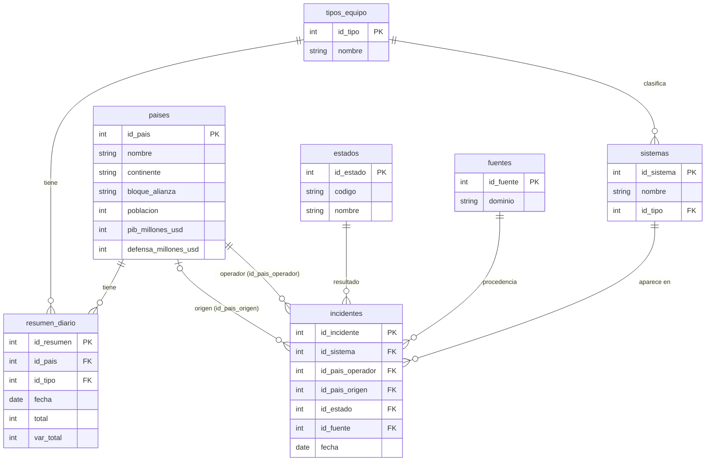

*El diagrama muestra solo los campos relevantes; `incidentes` y `resumen_diario` tienen columnas adicionales.*

| Tabla | Campos clave | Qué representa |
|---|---|---|
| `paises` | `id_pais`, `nombre`, `continente`, `bloque_alianza`, `poblacion`, `pib_millones_usd`, `defensa_millones_usd` | Datos geográficos, económicos y de defensa de cada país |
| `tipos_equipo` | `id_tipo`, `nombre` | Categorías generales de equipamiento militar (ej. *Tanks*, *Aircraft*) |
| `sistemas` | `id_sistema`, `nombre`, `id_tipo` | Modelos concretos de equipamiento, cada uno perteneciente a una categoría |
| `estados` | `id_estado`, `codigo`, `nombre` | Resultado del incidente: destruido, capturado, dañado o abandonado |
| `fuentes` | `id_fuente`, `dominio` | Dominios de las fuentes de información |
| `incidentes` | `id_sistema`, `id_pais_operador`, `id_pais_origen`, `id_estado`, `id_fuente`, `fecha` | Tabla de hechos: un incidente individual por fila (37.962 registros) |
| `resumen_diario` | `id_pais`, `id_tipo`, `fecha`, `total`, `var_total` | Valores **acumulados** y sus variaciones por país, tipo y fecha |

### Notas importantes

> - **`paises` participa dos veces en `incidentes`:** `id_pais_operador` (país que operaba el sistema) e `id_pais_origen` (país de origen del sistema cuando está disponible) apuntan a la misma clave `paises.id_pais`. Es fundamental elegir la clave foránea correcta según el rol requerido en cada `JOIN`.
> - **`resumen_diario` guarda acumulados:** para contabilizar registros nuevos a lo largo del tiempo deben sumarse las columnas de variación `var_*` (por ejemplo `var_total`), nunca los valores acumulados (`total`, `destruidos`, etc.).
> - **Estados:** 1 = `destroyed` (Destruido), 2 = `captured` (Capturado), 3 = `damaged` (Dañado), 4 = `abandoned` (Abandonado).

## Ejercicios

### Ejercicio 1. Consultar países europeos

**Consigna.** Mostrar `id_pais`, `nombre`, `bloque_alianza` y `poblacion` de los países cuyo `continente = 'Europa'`. Ordenar los resultados alfabéticamente por nombre. ¿Cuántos países devuelve la consulta?

**Técnicas:** `SELECT` · `WHERE` · `ORDER BY`

**Consulta**

```sql
SELECT id_pais
      ,nombre
      ,bloque_alianza
      ,poblacion
  FROM paises
 WHERE continente = 'Europa'
 ORDER BY nombre;
```

**Resultado** (24 filas)

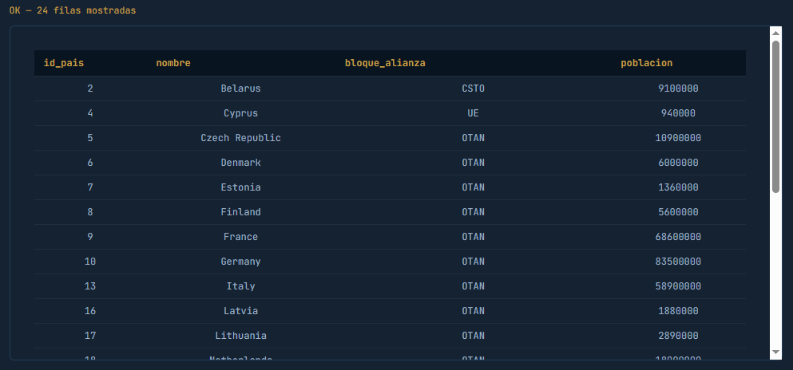

**Respuesta:** **24 países** europeos registrados en la base.

**Notas**

- Por defecto, `ORDER BY nombre` ordena de forma ascendente (`ASC`, alfabéticamente de la A a la Z).
- Se recomienda utilizar comillas simples (`'Europa'`) para literales de cadena según el estándar ANSI SQL, ya que las comillas dobles en algunos motores identifican nombres de columnas o tablas.

### Ejercicio 2. Incidentes recientes

**Consigna.** Mostrar `id_incidente`, `id_sistema`, `id_estado` y `fecha` de los incidentes cuya fecha sea posterior a `'2025-08-01'`. Ordenarlos por fecha de manera descendente. ¿Cuántos incidentes cumplen con la condición?

**Técnicas:** `SELECT` · `WHERE` (comparación de fechas) · `ORDER BY DESC`

**Consulta**

```sql
SELECT id_incidente
      ,id_sistema
      ,id_estado
      ,fecha
  FROM incidentes
 WHERE fecha > '2025-08-01'
 ORDER BY fecha DESC;
```

**Resultado** (341 filas)

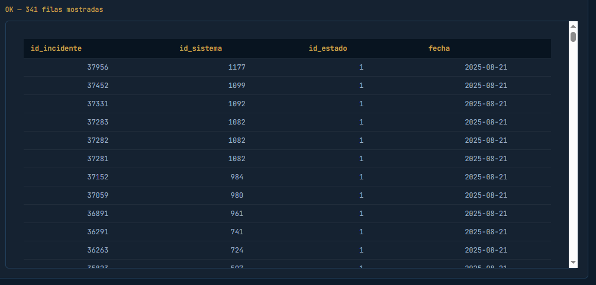

**Respuesta:** **341 incidentes** posteriores al 1 de agosto de 2025.

**Notas**

- Dado que el campo `fecha` almacena fechas en formato ISO 8601 (`YYYY-MM-DD`), la comparación lexicográfica de cadenas coincide exactamente con el orden cronológico.
- El operador `>` es estricto, por lo que excluye los incidentes ocurridos el propio `'2025-08-01'`.

### Ejercicio 3. Sistemas cuyo nombre no comience con "Unknown"

**Consigna.** Mostrar `nombre` e `id_tipo` de los sistemas cuyo nombre no empiece con `'Unknown'`. Ordenarlos alfabéticamente. ¿Cuántos sistemas devuelve la consulta?

**Técnicas:** `WHERE` · `NOT LIKE` (comodines) · `ORDER BY`

**Consulta**

```sql
SELECT nombre
      ,id_tipo
  FROM sistemas
 WHERE nombre NOT LIKE 'Unknown%'
 ORDER BY nombre;
```

**Resultado** (1.125 filas)

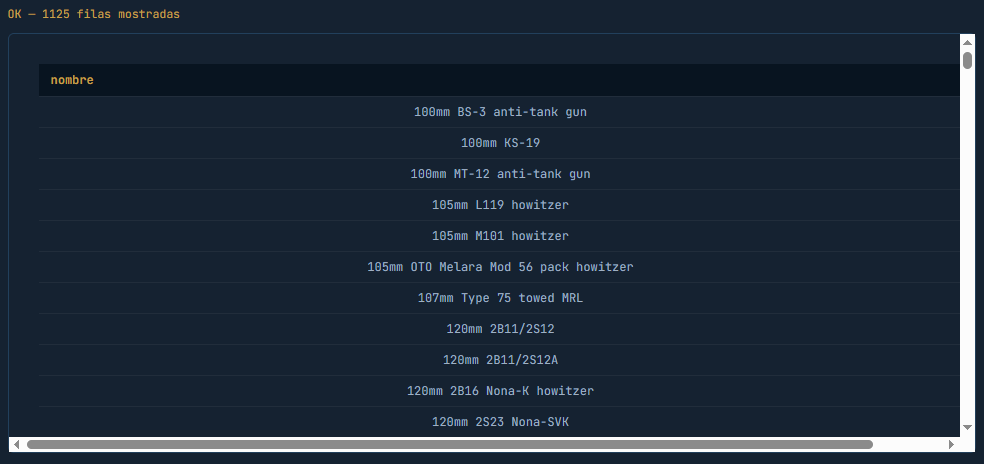

**Respuesta:** **1.125 sistemas** identificados (de un total de 1.186 sistemas en la tabla, 61 comienzan con `"Unknown"`).

**Notas**

- El comodín `%` representa cero, uno o más caracteres cualesquiera a continuación del prefijo `'Unknown'`.
- En SQLite, el operador `LIKE` es insensible a mayúsculas y minúsculas (*case-insensitive*) para caracteres ASCII por defecto.

### Ejercicio 4. Contar incidentes capturados

**Consigna.** En la tabla `estados`, el valor `id_estado = 2` corresponde al estado *Capturado*. ¿Cuántos incidentes registrados poseen `id_estado = 2`?

**Técnicas:** `COUNT` · `WHERE`

**Consulta**

```sql
SELECT COUNT(1) AS incidentes_capturados
  FROM incidentes
 WHERE id_estado = 2;
```

**Resultado** (1 fila)

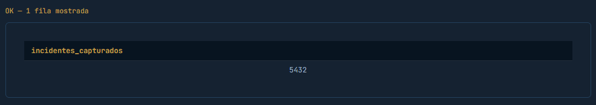

**Respuesta:** **5.432 incidentes** capturados.

**Notas**

- En SQLite, `COUNT(1)` y `COUNT(*)` tienen exactamente el mismo comportamiento y rendimiento: cuentan todas las filas que satisfacen la cláusula `WHERE`, sin importar si contienen valores `NULL` en alguna columna.

### Ejercicio 5. Cantidad de países por continente

**Consigna.** Contar los países agrupados por continente y mostrar solamente aquellos continentes que tengan 3 países o más. Ordenar los resultados de mayor a menor según la cantidad de países. ¿Cuál es el continente que posee mayor cantidad de países registrados?

**Técnicas:** `COUNT` · `GROUP BY` · `HAVING` · `ORDER BY DESC`

**Consulta**

```sql
SELECT continente
      ,COUNT(id_pais) AS cantidad_paises
  FROM paises
 GROUP BY continente
HAVING cantidad_paises >= 3
 ORDER BY cantidad_paises DESC;
```

**Resultado**

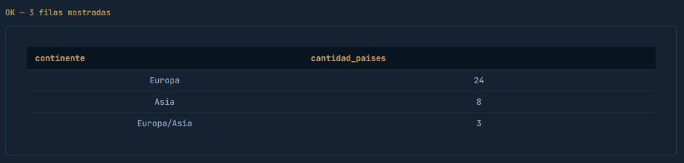

**Respuesta:** **Europa** es el continente con mayor cantidad de países registrados.

**Notas**

- La condición `>= 3` debe ubicarse en `HAVING` y no en `WHERE`, ya que filtra grupos completos luego de aplicar la función de agregación `COUNT`.
- SQLite permite referenciar el alias `cantidad_paises` en las cláusulas `HAVING` y `ORDER BY`, aunque en motores más estrictos (como PostgreSQL) se debe repetir la expresión `COUNT(id_pais)` dentro del `HAVING`.

### Ejercicio 6. Variaciones registradas por país y tipo de equipo

**Consigna.** Utilizando `resumen_diario`, sumar el campo `var_total` agrupando los registros por `id_pais` e `id_tipo`. Mostrar `id_pais`, `id_tipo` y el total obtenido. Ordenar el resultado de mayor a menor. ¿Qué combinación de `id_pais` e `id_tipo` aparece en primer lugar? Luego, utilizando consultas independientes sobre las tablas `paises` y `tipos_equipo`, determinar qué país y qué tipo de equipo representan esos identificadores.

**Técnicas:** `SUM` · `GROUP BY` (múltiples columnas) · `ORDER BY DESC` · `WHERE` por clave primaria

**Consultas**

*1. Variaciones totales por país y tipo de equipo*

```sql
SELECT id_pais
      ,id_tipo
      ,SUM(var_total) AS suma_var_total
  FROM resumen_diario
 GROUP BY id_pais
         ,id_tipo
 ORDER BY suma_var_total DESC;
```

**Resultado (a)**

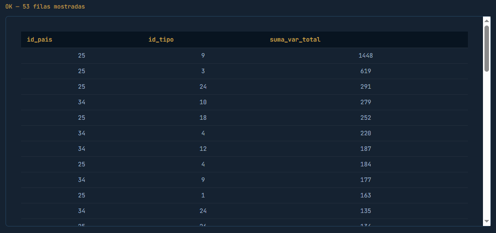

*2. Identificación del país (`id_pais = 25`)*

```sql
SELECT nombre
  FROM paises
 WHERE id_pais = 25;
```

**Resultado (b)**

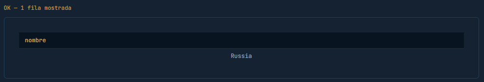

*3. Identificación del tipo de equipo (`id_tipo = 9`)*

```sql
SELECT nombre
  FROM tipos_equipo
 WHERE id_tipo = 9;
```

**Resultado (c)**

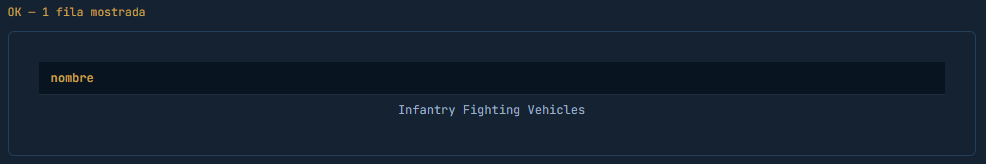

**Respuesta:** Combinación **25 / 9**, correspondiente a **Russia** / **Infantry Fighting Vehicles**.

**Notas**

- En `resumen_diario` se suma la columna de variación (`var_total`) y no `total`, porque `total` almacena valores acumulados diarios; sumarlo duplicaría los registros históricos.
- En el TP2 este mismo cruce de información se resuelve en una única consulta relacional encadenando cláusulas `JOIN`.

### Ejercicio 7. País con mayor gasto en defensa

**Consigna.** Mostrar `nombre`, `continente`, `pib_millones_usd` y `defensa_millones_usd` del país con mayor gasto en defensa. Utilizar `ORDER BY` y `LIMIT`.

**Técnicas:** `SELECT` · `ORDER BY DESC` · `LIMIT`

**Consulta**

```sql
SELECT nombre
      ,continente
      ,pib_millones_usd
      ,defensa_millones_usd
  FROM paises
 ORDER BY defensa_millones_usd DESC
 LIMIT 1;
```

**Resultado** (1 fila)

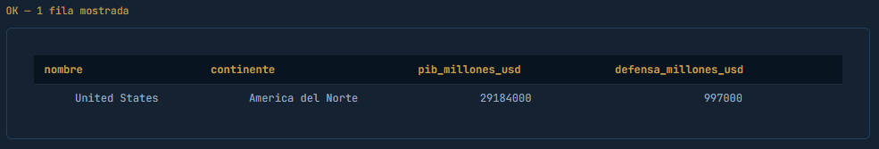

**Respuesta:** **United States**.

**Notas**

- En SQLite, al ordenar de forma descendente (`DESC`), los valores `NULL` (presentes en países históricos o sin dato como *North Korea*, *Soviet Union* y *Yugoslavia*) se ubican al final del resultado, por lo que no interfieren con el primer registro.
- `LIMIT 1` devuelve únicamente la primera fila; si existiera un empate en el máximo valor, cortaría arbitrariamente el resultado.

### Ejercicio 8. Incidentes recientes registrados para Ucrania

**Consigna.** Relacionar las tablas `incidentes` y `paises`. Mostrar `id_incidente`, `fecha`, `id_sistema`, `id_estado` y el nombre del país operador para aquellos incidentes cuyo país operador sea `'Ukraine'` y cuya fecha sea posterior a `'2025-08-01'`. Ordenar por fecha de manera descendente. ¿Cuál es la fecha del incidente más reciente?

**Técnicas:** `INNER JOIN` · `WHERE` (`AND`) · `ORDER BY DESC`

**Consulta**

```sql
SELECT i.id_incidente
      ,i.fecha
      ,i.id_sistema
      ,i.id_estado
      ,p.nombre
  FROM incidentes i
  INNER JOIN paises p ON i.id_pais_operador = p.id_pais
 WHERE p.nombre = 'Ukraine'
   AND i.fecha > '2025-08-01'
 ORDER BY i.fecha DESC;
```

**Resultado**

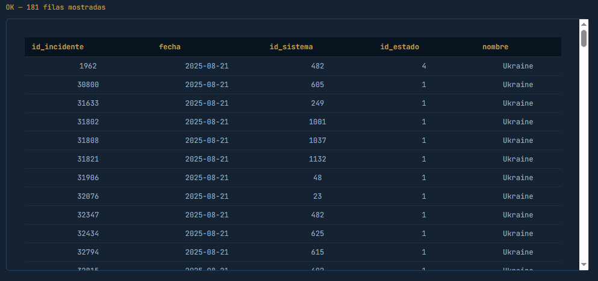

**Respuesta:** **2025-08-21** es la fecha del incidente más reciente registrado.

**Notas**

- La relación se establece explícitamente mediante `i.id_pais_operador = p.id_pais` para filtrar por el país que operaba el equipamiento y no por su país de fabricación (`id_pais_origen`).
- La fecha `2025-08-21` constituye el límite temporal superior de toda la tabla `incidentes`.

### Ejercicio 9. Sistemas clasificados como Aircraft

**Consigna.** Relacionar `sistemas` con `tipos_equipo`. Mostrar `id_sistema`, nombre del sistema y nombre del tipo de equipo para aquellos sistemas pertenecientes al tipo `'Aircraft'`. Ordenar por nombre del sistema. ¿Cuántos sistemas devuelve la consulta?

**Técnicas:** `INNER JOIN` · `WHERE` · `ORDER BY`

**Consulta**

```sql
SELECT s.id_sistema
      ,s.nombre AS nombre_sistema
      ,te.nombre AS nombre_tipo_equipo
  FROM sistemas s
  INNER JOIN tipos_equipo te ON te.id_tipo = s.id_tipo
 WHERE te.nombre = 'Aircraft'
 ORDER BY nombre_sistema;
```

**Resultado** (46 filas)

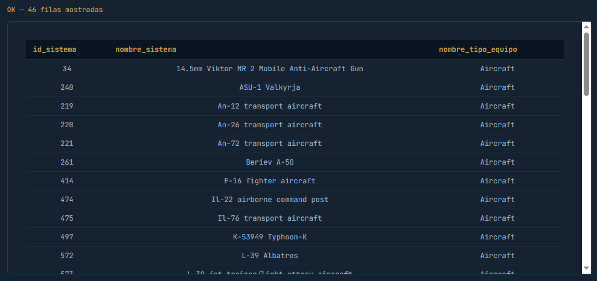

**Respuesta:** **46 sistemas** clasificados bajo la categoría `Aircraft`.

**Notas**

- El uso de alias de tabla (`s` y `te`) y alias de columna (`nombre_sistema`, `nombre_tipo_equipo`) evita ambigüedades dado que ambas tablas poseen una columna llamada `nombre`.

### Ejercicio 10. Gasto promedio en defensa

**Consigna.** Calcular el promedio global del campo `defensa_millones_usd` de la tabla `paises` utilizando la función `AVG()`.

**Técnicas:** `AVG` · `ROUND`

**Consulta**

```sql
SELECT ROUND(AVG(defensa_millones_usd), 2) AS gasto_militar_promedio
  FROM paises;
```

**Resultado** (1 fila)

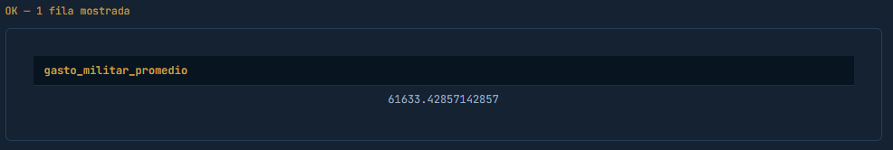

**Respuesta:** **61.633,43** millones de USD.

**Notas**

- La función de agregación `AVG()` ignora automáticamente los registros donde `defensa_millones_usd` es `NULL` (*North Korea*, *Soviet Union* y *Yugoslavia*), calculando el promedio sobre los **35 países** que sí cuentan con dato numérico.
- Se aplica `ROUND(..., 2)` para redondear el resultado a dos cifras decimales.

## Observaciones sobre los datos

- **Valores nulos en `paises`:** *North Korea*, *Soviet Union* y *Yugoslavia* no tienen registrado `defensa_millones_usd`; *Soviet Union* y *Yugoslavia* tampoco poseen dato de `poblacion`. En funciones como `AVG()` estos registros son omitidos del denominador.
- **Doble rol de `paises` en `incidentes`:** un mismo registro de incidente vincula dos países mediante `id_pais_operador` (quien operaba el equipo) e `id_pais_origen` (quien lo fabricó/originó). Confundir ambas claves foráneas altera por completo los resultados analíticos.
- **Naturaleza de `resumen_diario`:** almacena cortes acumulados por fecha (`destruidos`, `total`, etc.) junto con sus deltas diarios (`var_destruidos`, `var_total`). Para agregaciones en rangos de tiempo siempre deben sumarse las columnas `var_*`.
- **Formato temporal estándar:** el campo `fecha` se almacena como texto en formato ISO `YYYY-MM-DD` (sin componente horario), con cobertura desde `2022-03-19` hasta `2025-08-21`, lo que permite realizar comparaciones directas con operadores relacionales (`>`, `<`, `BETWEEN`).
- **Imágenes de evidencia:** las capturas de pantalla referenciadas (`img/p1-respuesta.PNG` a `img/p10-respuesta.PNG`) deben alojarse en el subdirectorio `img/` relativo a este archivo para su correcta visualización en repositorios Git.