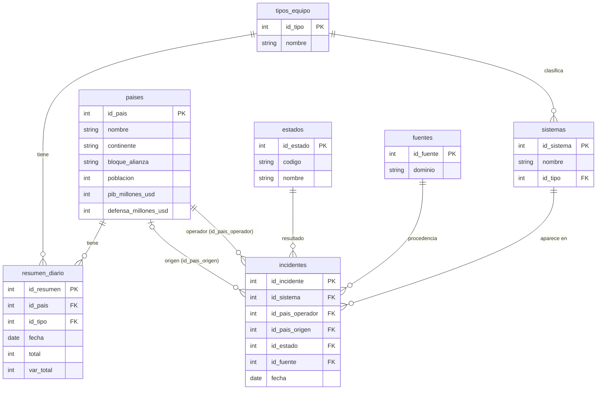

# TP2 – SQL Avanzado

**Sistemas de Tratamiento de Datos** · Licenciatura en Ciberdefensa · Facultad de Defensa Nacional (FADENA) · 2026

Resolución personal del Trabajo Práctico 2: consultas de solo lectura sobre la base `defensa_fadena` (SQLite), con foco en agregaciones sobre múltiples tablas, cálculos derivados y subconsultas. Cada ejercicio incluye la consigna, la consulta, el resultado obtenido, la respuesta y notas sobre las decisiones tomadas.

> **Aviso.** Material de estudio y referencia personal; no es la resolución oficial de la cátedra. La base `defensa_fadena.sqlite` la provee la cátedra y no se incluye en este repositorio.

## Índice

1. [Resumen de respuestas](#resumen-de-respuestas)
2. [Entorno y cómo reproducir los resultados](#entorno-y-cómo-reproducir-los-resultados)
3. [Modelo de datos](#modelo-de-datos)
4. [Ejercicios](#ejercicios)
5. [Observaciones sobre los datos](#observaciones-sobre-los-datos)
6. [Recursos](#recursos)

## Resumen de respuestas

| # | Tema | Respuesta |
|--:|---|---|
| 1 | [Top-5 tipos de equipo con más incidentes](#ejercicio-1-top-5-tipos-de-equipo-con-más-incidentes) | Infantry Fighting Vehicles (7.445) |
| 2 | [Top-5 sistemas con más incidentes destruidos](#ejercicio-2-top-5-sistemas-con-más-incidentes-destruidos) | BMP-2K (1.390) |
| 3 | [Porcentaje de incidentes destruidos por tipo de equipo](#ejercicio-3-porcentaje-de-incidentes-destruidos-por-tipo-de-equipo) | Helicopters (81,89 %) |
| 4 | [Variación de incidentes entre 2024 y 2025 por tipo de equipo](#ejercicio-4-variación-de-incidentes-entre-2024-y-2025-por-tipo-de-equipo) | Mine-Resistant Ambush Protected (+206) |
| 5 | [Top-5 fuentes con mayor variedad de sistemas](#ejercicio-5-top-5-fuentes-con-mayor-variedad-de-sistemas) | i.postimg.cc (1.108) |
| 6 | [Incidentes por millón de habitantes](#ejercicio-6-incidentes-por-millón-de-habitantes) | Ukraine (293,94) |
| 7 | [Tipos de equipo por encima del promedio de incidentes](#ejercicio-7-tipos-de-equipo-por-encima-del-promedio-de-incidentes) | 6 tipos |
| 8 | [Diferencia entre Tanks y el promedio de incidentes](#ejercicio-8-diferencia-entre-tanks-y-el-promedio-de-incidentes) | +5.951,97 sobre el promedio |
| 9 | [Países con gasto en defensa superior al promedio global](#ejercicio-9-países-con-gasto-en-defensa-superior-al-promedio-global) | 6 países |
| 10 | [Países con gasto superior al promedio que no son operadores](#ejercicio-10-países-con-gasto-superior-al-promedio-que-no-son-operadores) | 5 países (US, China, Germany, UK, France) |

## Entorno y cómo reproducir los resultados

- **Motor:** SQLite (resultados verificados con la versión 3.45.1).
- **Base de datos:** `defensa_fadena.sqlite`, provista por la cátedra.
- **Herramienta online** de la Facultad: <https://fadena-sql.fadena.workers.dev/>

Para ejecutar una consulta desde la línea de comandos y obtener el resultado ya en formato de tabla Markdown (versiones recientes de SQLite):

```bash
sqlite3 defensa_fadena.sqlite
.headers on
.mode markdown
-- pegar aquí la consulta
```

**Convención temporal.** Para comparar 2024 con 2025 se usa el mismo período en ambos años: del 1 de enero al 21 de agosto, porque 2025-08-21 es la última fecha disponible en la base.

## Modelo de datos

La base tiene 38 países, 29 tipos de equipo, 1.186 sistemas, 17 fuentes, 4 estados, 37.962 incidentes y 1.091 registros de resumen diario.



*El diagrama muestra solo los campos relevantes; `incidentes` y `resumen_diario` tienen columnas adicionales.*

| Tabla | Campos clave | Qué representa |
|---|---|---|
| `paises` | `id_pais`, `nombre`, `poblacion`, `defensa_millones_usd` | Datos geográficos, económicos y de defensa de cada país |
| `tipos_equipo` | `id_tipo`, `nombre` | Categorías generales de equipamiento (ej. *Tanks*, *Helicopters*) |
| `sistemas` | `id_sistema`, `nombre`, `id_tipo` | Modelos concretos de equipamiento, cada uno de una categoría |
| `estados` | `id_estado`, `codigo`, `nombre` | Resultado del incidente: destruido, capturado, dañado o abandonado |
| `fuentes` | `id_fuente`, `dominio` | Dominios de las fuentes de información |
| `incidentes` | `id_sistema`, `id_pais_operador`, `id_pais_origen`, `id_estado`, `id_fuente`, `fecha` | Tabla de hechos: un incidente por fila (37.962) |
| `resumen_diario` | `id_pais`, `id_tipo`, `fecha`, `total`, `var_total` | Valores **acumulados** y sus variaciones por país, tipo y fecha |

### Notas importantes

> - **`paises` participa dos veces en `incidentes`:** `id_pais_operador` (quien operaba el sistema) e `id_pais_origen` (origen del sistema; según el glosario puede faltar, aunque en esta base no hay nulos) apuntan a la misma clave `paises.id_pais`. Hay que elegir el rol correcto en cada `JOIN`.
> - **`resumen_diario` guarda acumulados:** para contar registros nuevos a lo largo del tiempo se deben sumar las columnas `var_*` (por ejemplo `var_total`), no los valores acumulados.
> - **Estados:** 1 = `destroyed` (Destruido), 2 = `captured` (Capturado), 3 = `damaged` (Dañado), 4 = `abandoned` (Abandonado).

## Ejercicios

### Ejercicio 1. Top-5 tipos de equipo con más incidentes

**Consigna.** Relacionar `incidentes`, `sistemas` y `tipos_equipo`, contar los incidentes por tipo y quedarse con los cinco más frecuentes. ¿Qué tipo lidera?

**Técnicas:** `JOIN` · `COUNT` · `GROUP BY` · `ORDER BY` · `LIMIT`

**Consulta**

```sql
SELECT te.nombre AS tipo_equipo
      ,COUNT(i.id_incidente) AS cantidad_incidentes
  FROM incidentes i
  JOIN sistemas s ON s.id_sistema = i.id_sistema
  JOIN tipos_equipo te ON te.id_tipo = s.id_tipo
 GROUP BY te.id_tipo, te.nombre
 ORDER BY cantidad_incidentes DESC
 LIMIT 5;
```

**Resultado** (5 filas)

| tipo_equipo | cantidad_incidentes |
|---|--:|
| Infantry Fighting Vehicles | 7445 |
| Tanks | 7261 |
| Trucks, Vehicles, and Jeeps | 6795 |
| Armoured Personnel Carriers | 5305 |
| Armoured Fighting Vehicles | 2052 |

**Respuesta:** **Infantry Fighting Vehicles**, con 7.445 incidentes.

**Notas**

- Agrupar por la clave primaria (`id_tipo`) además del nombre es más portable que agrupar por alias, aunque acá `nombre` es único.
- Control: la suma de los incidentes de **todos** los tipos da 37.962, igual que el total de la tabla `incidentes`. No se pierde ni se duplica ninguna fila en los `JOIN`.
- `LIMIT 5` corta de forma arbitraria si hay empate en el quinto puesto; acá no ocurre.

### Ejercicio 2. Top-5 sistemas con más incidentes destruidos

**Consigna.** Relacionar `incidentes`, `sistemas` y `estados`, considerar solo los incidentes en estado *Destruido* y obtener los cinco sistemas con más casos.

**Técnicas:** `JOIN` · `WHERE` · `GROUP BY` · `ORDER BY` · `LIMIT`

**Consulta**

```sql
SELECT s.nombre AS sistema
      ,COUNT(i.id_incidente) AS cantidad_destruidos
  FROM incidentes i
  JOIN sistemas s ON s.id_sistema = i.id_sistema
  JOIN estados e ON e.id_estado = i.id_estado
 WHERE e.nombre = 'Destruido'
 GROUP BY s.id_sistema, s.nombre
 ORDER BY cantidad_destruidos DESC
 LIMIT 5;
```

**Resultado** (5 filas)

| sistema | cantidad_destruidos |
|---|--:|
| BMP-2K | 1390 |
| MT-LB | 1358 |
| BMP-1(P) | 1262 |
| Ural-4320 | 1173 |
| KamAZ 6x6 | 1035 |

**Respuesta:** **BMP-2K**, con 1.390 incidentes destruidos.

**Notas**

- Filtrar por `e.codigo = 'destroyed'` (o `i.id_estado = 1`) es una alternativa más robusta que depender del texto en español.

### Ejercicio 3. Porcentaje de incidentes destruidos por tipo de equipo

**Consigna.** Para cada tipo de equipo con **100 incidentes o más**, calcular qué porcentaje del total corresponde a incidentes destruidos. Mostrar total, destruidos y porcentaje. ¿Qué tipo tiene el porcentaje más alto?

**Técnicas:** Subconsultas en `FROM` (tablas derivadas) · `HAVING` · `ROUND`

**Consulta**

```sql
SELECT t.tipo_equipo
      ,t.total_incidentes
      ,d.destruidos
      ,ROUND(d.destruidos * 100.0 / t.total_incidentes, 2) AS porcentaje_destruidos
  FROM (SELECT te.id_tipo
              ,te.nombre AS tipo_equipo
              ,COUNT(*) AS total_incidentes
          FROM incidentes i
          JOIN sistemas s ON s.id_sistema = i.id_sistema
          JOIN tipos_equipo te ON te.id_tipo = s.id_tipo
         GROUP BY te.id_tipo, te.nombre
        HAVING COUNT(*) >= 100) t
  JOIN (SELECT s.id_tipo
              ,COUNT(*) AS destruidos
          FROM incidentes i
          JOIN sistemas s ON s.id_sistema = i.id_sistema
          JOIN estados e ON e.id_estado = i.id_estado
         WHERE e.nombre = 'Destruido'
         GROUP BY s.id_tipo) d ON d.id_tipo = t.id_tipo
 ORDER BY porcentaje_destruidos DESC;
```

**Resultado** (21 filas)

<details>
<summary>Ver tabla completa</summary>

| tipo_equipo | total_incidentes | destruidos | porcentaje_destruidos |
|---|--:|--:|--:|
| Helicopters | 243 | 199 | 81.89 |
| Self-Propelled Artillery | 1575 | 1269 | 80.57 |
| Aircraft | 569 | 458 | 80.49 |
| Trucks, Vehicles, and Jeeps | 6795 | 5181 | 76.25 |
| Multiple Rocket Launchers | 591 | 446 | 75.47 |
| Surface-To-Air Missile Systems | 709 | 522 | 73.62 |
| Infantry Mobility Vehicles | 1055 | 761 | 72.13 |
| Armoured Personnel Carriers | 5305 | 3786 | 71.37 |
| Infantry Fighting Vehicles | 7445 | 5298 | 71.16 |
| Unmanned Combat Aerial Vehicles | 506 | 353 | 69.76 |
| Armoured Fighting Vehicles | 2052 | 1378 | 67.15 |
| Radars | 137 | 92 | 67.15 |
| Mine-Resistant Ambush Protected | 727 | 485 | 66.71 |
| Tanks | 7261 | 4702 | 64.76 |
| Self-Propelled Anti-Aircraft Guns | 156 | 100 | 64.1 |
| Towed Artillery | 908 | 544 | 59.91 |
| Reconnaissance Unmanned Aerial Vehicles | 228 | 126 | 55.26 |
| Engineering Vehicles And Equipment | 827 | 452 | 54.66 |
| Command Posts And Communications Stations | 363 | 192 | 52.89 |
| Naval Ships | 137 | 66 | 48.18 |
| Self-Propelled Anti-Tank Missile Systems | 117 | 33 | 28.21 |

</details>

**Respuesta:** **Helicopters**, con 81,89 % (199 destruidos sobre 243 incidentes).

**Notas**

- **La fórmula de la consigna está invertida.** El enunciado sugiere `total_incidentes * 100.0 / total_destruidos`, pero el porcentaje de destruidos es `destruidos * 100.0 / total_incidentes`. Con la versión invertida se obtienen valores mayores a 100 % (por ejemplo, 354,55 % para *Self-Propelled Anti-Tank Missile Systems*), lo que delata el error.
- El filtro de 100 incidentes va en el `HAVING` de la subconsulta de totales, porque se aplica sobre un conteo por grupo.
- Se usa `100.0` (no `100`) para evitar la división entera de SQLite.
- El `JOIN` interno entre ambas subconsultas es seguro en este caso: los 21 tipos con 100 o más incidentes tienen al menos un destruido. Si no fuera así, habría que usar `LEFT JOIN` + `COALESCE`.

### Ejercicio 4. Variación de incidentes entre 2024 y 2025 por tipo de equipo

**Consigna.** Comparar la cantidad de incidentes por tipo entre el 1/1 y el 21/8 de 2024 contra el mismo período de 2025, y calcular la variación absoluta. ¿Qué tipo tuvo el mayor crecimiento?

**Técnicas:** Subconsultas en `FROM` · `BETWEEN` · comparación temporal

**Consulta**

```sql
SELECT a.tipo_equipo
      ,a.incidentes_2024
      ,b.incidentes_2025
      ,b.incidentes_2025 - a.incidentes_2024 AS variacion
  FROM (SELECT te.id_tipo
              ,te.nombre AS tipo_equipo
              ,COUNT(*) AS incidentes_2024
          FROM incidentes i
          JOIN sistemas s ON s.id_sistema = i.id_sistema
          JOIN tipos_equipo te ON te.id_tipo = s.id_tipo
         WHERE i.fecha BETWEEN '2024-01-01' AND '2024-08-21'
         GROUP BY te.id_tipo, te.nombre) a
  JOIN (SELECT s.id_tipo
              ,COUNT(*) AS incidentes_2025
          FROM incidentes i
          JOIN sistemas s ON s.id_sistema = i.id_sistema
         WHERE i.fecha BETWEEN '2025-01-01' AND '2025-08-21'
         GROUP BY s.id_tipo) b ON b.id_tipo = a.id_tipo
 ORDER BY variacion DESC;
```

**Resultado** (25 filas)

<details>
<summary>Ver tabla completa</summary>

| tipo_equipo | incidentes_2024 | incidentes_2025 | variacion |
|---|--:|--:|--:|
| Mine-Resistant Ambush Protected | 78 | 284 | 206 |
| Infantry Mobility Vehicles | 110 | 297 | 187 |
| Armoured Fighting Vehicles | 311 | 402 | 91 |
| Unmanned Ground Vehicles | 3 | 50 | 47 |
| Command Posts And Communications Stations | 20 | 50 | 30 |
| Reconnaissance Unmanned Aerial Vehicles | 2 | 22 | 20 |
| Unmanned Combat Aerial Vehicles | 88 | 104 | 16 |
| Anti-Aircraft Guns | 2 | 4 | 2 |
| Artillery Support Vehicles And Equipment | 13 | 10 | -3 |
| Naval Ships | 27 | 24 | -3 |
| Jammers And Deception Systems | 7 | 3 | -4 |
| Self-Propelled Anti-Tank Missile Systems | 5 | 1 | -4 |
| Helicopters | 22 | 16 | -6 |
| Radars | 32 | 18 | -14 |
| Self-Propelled Anti-Aircraft Guns | 32 | 14 | -18 |
| Multiple Rocket Launchers | 101 | 71 | -30 |
| Self-Propelled Artillery | 292 | 262 | -30 |
| Towed Artillery | 153 | 116 | -37 |
| Armoured Personnel Carriers | 1041 | 996 | -45 |
| Surface-To-Air Missile Systems | 139 | 85 | -54 |
| Aircraft | 136 | 80 | -56 |
| Engineering Vehicles And Equipment | 269 | 123 | -146 |
| Trucks, Vehicles, and Jeeps | 965 | 744 | -221 |
| Infantry Fighting Vehicles | 1671 | 1105 | -566 |
| Tanks | 1553 | 861 | -692 |

</details>

**Respuesta:** **Mine-Resistant Ambush Protected**: pasó de 78 a 284 incidentes (**+206**).

**Notas**

- `fecha` se guarda como texto `YYYY-MM-DD` sin hora, por eso `BETWEEN` con ambos extremos incluidos es correcto.
- El `JOIN` interno devuelve 25 de los 29 tipos. Quedan afuera cuatro tipos que no tienen incidentes en 2024: dos no tienen en ninguno de los dos períodos y los otros dos (*Rocket and Missile Artillery* y *Trucks, Vehicles, Jeeps, and Trains*) tienen 2 y 1 en 2025. No cambia el ganador; para incluirlos habría que usar `LEFT JOIN` + `COALESCE`.
- La consigna pide crecimiento **absoluto**. En términos relativos el ranking sería otro, ya que varios tipos parten de bases muy pequeñas (por ejemplo, *Unmanned Ground Vehicles* pasó de 3 a 50).

### Ejercicio 5. Top-5 fuentes con mayor variedad de sistemas

**Consigna.** Para cada dominio de `fuentes`, contar cuántos sistemas distintos aparecen asociados a sus incidentes y mostrar las cinco con mayor variedad.

**Técnicas:** `JOIN` · `COUNT(DISTINCT ...)` · `GROUP BY` · `LIMIT`

**Consulta**

```sql
SELECT f.dominio
      ,COUNT(DISTINCT i.id_sistema) AS sistemas_distintos
  FROM incidentes i
  JOIN fuentes f ON f.id_fuente = i.id_fuente
 GROUP BY f.id_fuente, f.dominio
 ORDER BY sistemas_distintos DESC
 LIMIT 5;
```

**Resultado** (5 filas)

| dominio | sistemas_distintos |
|---|--:|
| i.postimg.cc | 1108 |
| twitter.com | 416 |
| postimg.cc | 136 |
| postlmg.cc | 56 |
| x.com | 12 |

**Respuesta:** **i.postimg.cc**, con 1.108 sistemas distintos.

**Notas**

- Sin `DISTINCT`, `COUNT` contaría incidentes (una fuente con muchos incidentes del mismo sistema inflaría el resultado). Con `DISTINCT` se cuentan sistemas únicos.
- En los datos existe el dominio `postlmg.cc` (con "l" en lugar de "i"), probablemente un error de carga o de la fuente original. Se respeta tal cual está en la base.

### Ejercicio 6. Incidentes por millón de habitantes

**Consigna.** Para cada país operador, calcular `cantidad_incidentes × 1.000.000 / poblacion`. ¿Qué país operador tiene el valor más alto?

**Técnicas:** Subconsulta en `FROM` · `JOIN` con `paises` · cálculo derivado

**Consulta**

```sql
SELECT p.nombre AS pais
      ,x.cantidad_incidentes
      ,p.poblacion
      ,ROUND(x.cantidad_incidentes * 1000000.0 / p.poblacion, 2) AS incidentes_por_millon
  FROM (SELECT id_pais_operador
              ,COUNT(*) AS cantidad_incidentes
          FROM incidentes
         GROUP BY id_pais_operador) x
  JOIN paises p ON p.id_pais = x.id_pais_operador
 ORDER BY incidentes_por_millon DESC;
```

**Resultado** (2 filas)

| pais | cantidad_incidentes | poblacion | incidentes_por_millon |
|---|--:|--:|--:|
| Ukraine | 11111 | 37800000 | 293.94 |
| Russia | 26851 | 143500000 | 187.11 |

**Respuesta:** **Ukraine**, con 293,94 incidentes por millón de habitantes (Russia: 187,11).

**Notas**

- En toda la base solo hay **dos** países operadores: Ukraine y Russia.
- El `JOIN` se hace por `id_pais_operador`, no por `id_pais_origen`: `paises` participa dos veces en `incidentes` con roles distintos.
- Se multiplica por `1000000.0` para forzar aritmética decimal. Ningún operador tiene `poblacion` nula o cero.

### Ejercicio 7. Tipos de equipo por encima del promedio de incidentes

**Consigna.** Calcular los incidentes por tipo y mostrar solo los tipos cuya cantidad supera el promedio entre todos los tipos. ¿Cuántos son?

**Técnicas:** Subconsulta en `HAVING` · subconsulta anidada con `AVG`

**Consulta**

```sql
SELECT te.nombre AS tipo_equipo
      ,COUNT(*) AS cantidad_incidentes
  FROM incidentes i
  JOIN sistemas s ON s.id_sistema = i.id_sistema
  JOIN tipos_equipo te ON te.id_tipo = s.id_tipo
 GROUP BY te.id_tipo, te.nombre
HAVING COUNT(*) > (SELECT AVG(t.cantidad)
                     FROM (SELECT COUNT(*) AS cantidad
                             FROM incidentes i2
                             JOIN sistemas s2 ON s2.id_sistema = i2.id_sistema
                            GROUP BY s2.id_tipo) t)
 ORDER BY cantidad_incidentes DESC;
```

**Resultado** (6 filas)

| tipo_equipo | cantidad_incidentes |
|---|--:|
| Infantry Fighting Vehicles | 7445 |
| Tanks | 7261 |
| Trucks, Vehicles, and Jeeps | 6795 |
| Armoured Personnel Carriers | 5305 |
| Armoured Fighting Vehicles | 2052 |
| Self-Propelled Artillery | 1575 |

**Respuesta:** **6 tipos** superan el promedio (1.309,03 incidentes por tipo).

**Notas**

- La condición va en `HAVING` y no en `WHERE` porque compara contra un valor agregado (el conteo por grupo).
- No se puede escribir `AVG(COUNT(*))` directamente: SQL no permite anidar agregados, por eso se calcula primero el conteo por tipo en una tabla derivada y luego se promedia.
- El promedio es sobre los 29 tipos, ya que todos tienen al menos un incidente (no hay tipos "vacíos" que distorsionen el promedio).

### Ejercicio 8. Diferencia entre Tanks y el promedio de incidentes

**Consigna.** Mostrar los incidentes del tipo *Tanks*, el promedio general entre todos los tipos y la diferencia entre ambos.

**Técnicas:** Subconsulta escalar en `SELECT` (no correlacionada) · `AVG` sobre subconsulta anidada

**Consulta**

```sql
SELECT te.nombre AS tipo_equipo
      ,COUNT(*) AS cantidad_incidentes
      ,(SELECT ROUND(AVG(t.cantidad), 2)
          FROM (SELECT COUNT(*) AS cantidad
                  FROM incidentes i2
                  JOIN sistemas s2 ON s2.id_sistema = i2.id_sistema
                 GROUP BY s2.id_tipo) t) AS promedio_general
      ,ROUND(COUNT(*) - (SELECT AVG(t.cantidad)
                           FROM (SELECT COUNT(*) AS cantidad
                                   FROM incidentes i2
                                   JOIN sistemas s2 ON s2.id_sistema = i2.id_sistema
                                  GROUP BY s2.id_tipo) t), 2) AS diferencia_promedio
  FROM incidentes i
  JOIN sistemas s ON s.id_sistema = i.id_sistema
  JOIN tipos_equipo te ON te.id_tipo = s.id_tipo
 WHERE te.nombre = 'Tanks'
 GROUP BY te.id_tipo, te.nombre;
```

**Resultado**

| tipo_equipo | cantidad_incidentes | promedio_general | diferencia_promedio |
|---|--:|--:|--:|
| Tanks | 7261 | 1309.03 | 5951.97 |

**Respuesta:** Tanks está **5.951,97 incidentes por encima** del promedio (7.261 contra 1.309,03).

**Notas**

- La subconsulta es **no correlacionada**: no depende de la fila externa, por lo que se evalúa una sola vez.
- Se escribe dos veces (para mostrar el promedio y para calcular la diferencia). Alternativa más prolija: calcular el promedio en una tabla derivada y hacer `CROSS JOIN` con ella.

### Ejercicio 9. Países con gasto en defensa superior al promedio global

**Consigna.** Calcular el promedio global de `defensa_millones_usd` y mostrar solo los países que lo superan, de mayor a menor gasto. ¿Cuántos son?

**Técnicas:** Subconsulta escalar en `WHERE`

**Consulta**

```sql
SELECT nombre
      ,defensa_millones_usd
  FROM paises
 WHERE defensa_millones_usd > (SELECT AVG(defensa_millones_usd)
                                 FROM paises)
 ORDER BY defensa_millones_usd DESC;
```

**Resultado** (6 filas)

| nombre | defensa_millones_usd |
|---|--:|
| United States | 997000 |
| China | 314000 |
| Russia | 149000 |
| Germany | 88500 |
| United Kingdom | 81800 |
| France | 64700 |

**Respuesta:** **6 países** superan el promedio de 61.633,43 millones de USD.

**Notas**

- `AVG` ignora los valores `NULL`. North Korea, Soviet Union y Yugoslavia no tienen dato de gasto, así que el promedio se calcula sobre **35 de los 38 países**.
- La comparación es estricta (`>`), igual que en la consigna.

### Ejercicio 10. Países con gasto superior al promedio que no son operadores

**Consigna.** Entre los países cuyo gasto supera el promedio global, listar los que **nunca** aparecen como país operador en un incidente. ¿Cuántos son y cuáles?

**Técnicas:** Subconsulta escalar · `NOT EXISTS` (subconsulta correlacionada)

**Consulta**

```sql
SELECT p.nombre
      ,p.defensa_millones_usd
  FROM paises p
 WHERE p.defensa_millones_usd > (SELECT AVG(defensa_millones_usd)
                                   FROM paises)
   AND NOT EXISTS (SELECT 1
                     FROM incidentes i
                    WHERE i.id_pais_operador = p.id_pais)
 ORDER BY p.defensa_millones_usd DESC;
```

**Resultado** (5 filas)

| nombre | defensa_millones_usd |
|---|--:|
| United States | 997000 |
| China | 314000 |
| Germany | 88500 |
| United Kingdom | 81800 |
| France | 64700 |

**Respuesta:** **5 países**: United States, China, Germany, United Kingdom y France.

**Notas**

- Respecto del ejercicio 9, queda afuera **Russia**, que sí figura como operador.
- `NOT EXISTS` es preferible a `NOT IN`: si la subconsulta devolviera algún `NULL`, `NOT IN` no devolvería ninguna fila. Acá `id_pais_operador` es `NOT NULL`, pero `NOT EXISTS` es la opción segura en general y además suele ser más eficiente.

## Observaciones sobre los datos

- **Categorías casi duplicadas en `tipos_equipo`:** conviven, por ejemplo, *Naval Ships* y *Naval Ships and Submarines*, *Radars* y *Radars And Communications Equipment*, o *Trucks, Vehicles, and Jeeps* y *Trucks, Vehicles, Jeeps, and Trains*. Los análisis por tipo las tratan como categorías separadas.
- **Valores nulos en `paises`:** North Korea, Soviet Union y Yugoslavia no tienen `defensa_millones_usd`; Soviet Union y Yugoslavia tampoco tienen `poblacion`. Esto afecta a los promedios (los `NULL` se ignoran en `AVG`).
- **Solo dos países operadores:** `incidentes.id_pais_operador` contiene únicamente Ukraine y Russia, lo que limita el alcance de los ejercicios 6 y 10.
- **Fechas:** `fecha` es texto `YYYY-MM-DD` (sin hora), con rango del 2022-03-19 al 2025-08-21.
- **Dominio con error tipográfico:** `postlmg.cc` en la tabla `fuentes`.

## Recursos
- base de datos en formato SQLite: [defensa_fadena.sqlite](recursos/defensa_fadena.sqlite)
- base de datos en formato MySQL: [defensa_fadena_mysql_mariadb.sql](recursos/defensa_fadena_mysql_mariadb.sql)
- base de datos en línea de la cátedra: [https://fadena-sql.fadena.workers.dev/](https://fadena-sql.fadena.workers.dev/)
